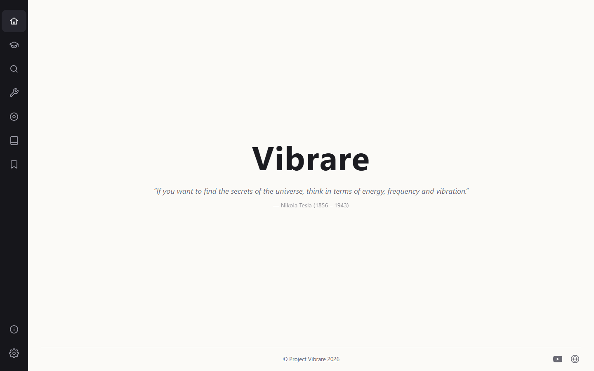
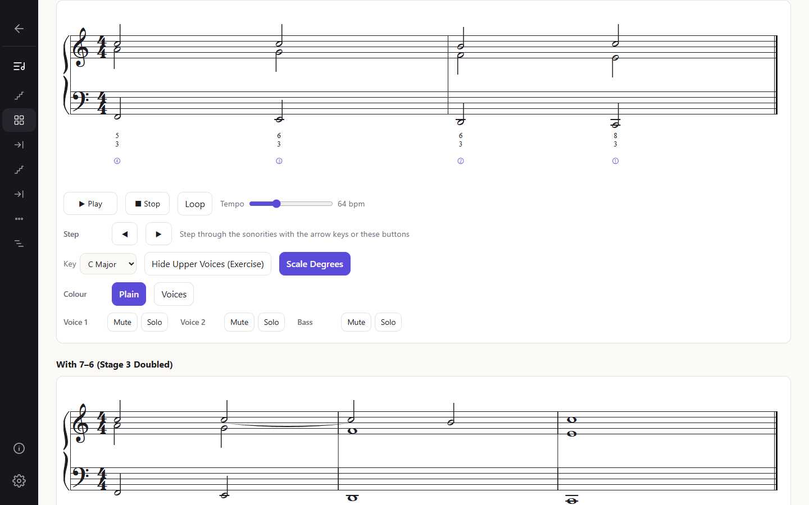
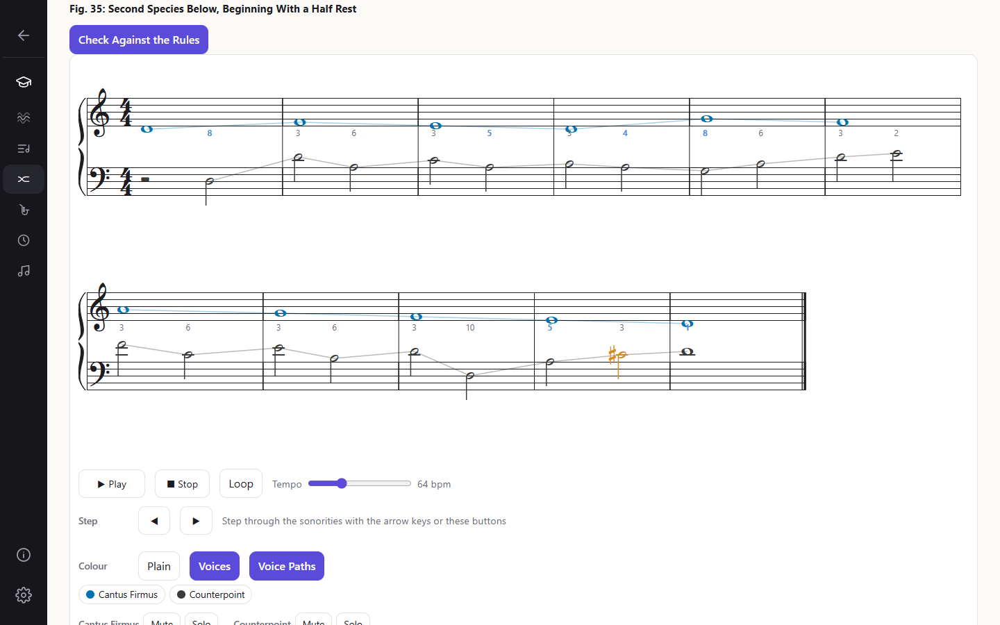
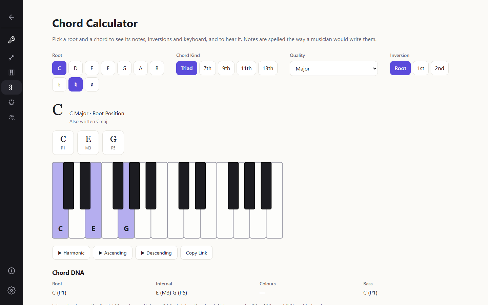
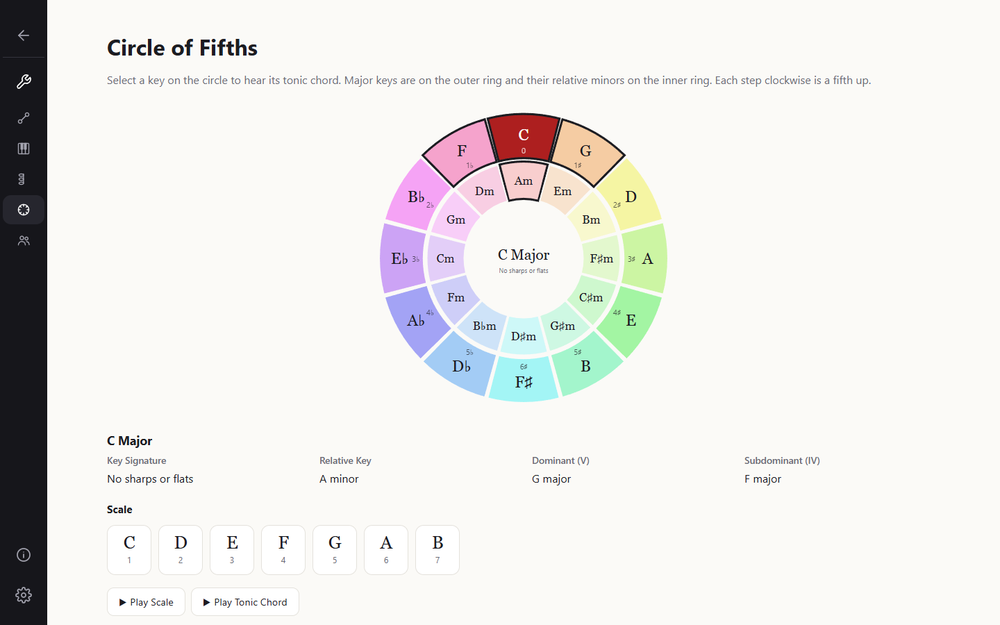
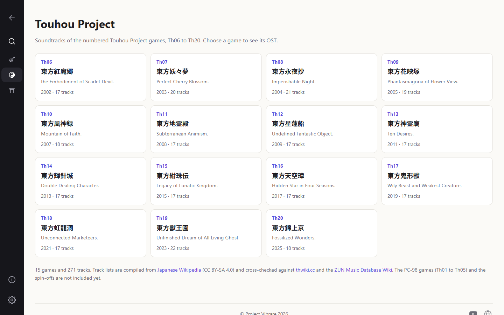
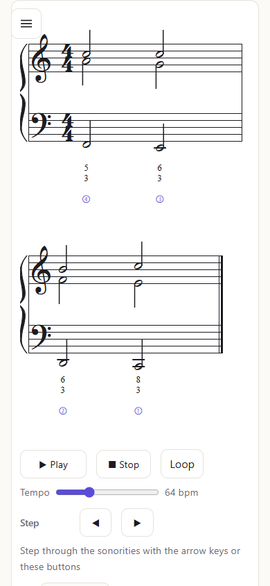

# Project Vibrare

A personal study notebook and archive about music: theory, analysis and arranging. It brings together notes,
small interactive tools, reference lists and a collection of arrangements.

Live site: <https://vibrare.pages.dev/>

## Screenshots

<table>
  <tr>
    <td> The home page and the drill-down menu.</td>
    <td> A Partimento pattern with a playable score, figured bass and exercise mode.</td>
  </tr>
  <tr>
    <td> The Counterpoint rule checker on one of Fux's examples.</td>
    <td> The chord calculator with inversions and a keyboard.</td>
  </tr>
  <tr>
    <td> The interactive circle of fifths.</td>
    <td> The Touhou Project OST pages.</td>
  </tr>
  <tr>
    <td colspan="2" align="center"> The same score on a phone.</td>
  </tr>
</table>

## What is on the site

| Section | Contents |
| :-- | :-- |
| **Theory** | *Tonal Harmony* (74 topics and 154 playable scores, from the owner's notes on Dr. B's lessons), *Partimento* (96 patterns and 156 playable scores in six pages: Moti del Basso, Schemata, Cadences, Rule of the Octave, Suspension and Diminution; and *Fugue*, with Mann's theory and an analysis guide), *Counterpoint* (Fux's *Gradus ad Parnassum*, with 22 playable examples, a rule checker that marks faulty notes, 15 exercise workbenches and 7 tools), *HIP* (historically informed performance for flute and keyboard, with 17 playable examples), *Music History* (32 articles on the history of music theory after Christensen, with an era map, timeline, people, glossary and quiz; the technique that overlaps sits as "History Background" panels in the other tabs) and *Jazz* (not written yet). Each rule and guideline is badged apart. See [Status](#status). |
| **Analysis** | *Baroque*: *Bach* lists the 48 preludes and fugues of *The Well-Tempered Clavier* (BWV 846 to 893) with keys and fugue voice counts; each fugue also has its own analysis page, with Roberts's method and four organ fugues, and *First Lessons in Bach*; *Quantz* has the 100 daily exercises, an articulation guide and the Flute Concerto QV 5:174; *Blavet* has the sonata "La Vibray". *Touhou Project*: the numbered games Th06 to Th20 (15 games, 271 tracks), each with its OST, where every track is used, and its BPM and key where the wiki below has them. *Japanese Music*: eleven chapters of study guides, with their resources and licenses. |
| **Tools** | Interval and scale calculators that show the notes on a staff; a chord calculator with inversions, a piano keyboard, playback and shareable links; an interactive circle of fifths with a rainbow colour scheme that draws a chord's shape (triangle, square, and so on). Notes are spelled the way a musician would write them. |
| **Works** | Arrangements by category: Anime, Commissions, Concert Band, Flute, Ghibli, Touhou Project, Vocaloid, VTubers, Miscellaneous. Three arrangements are listed so far. |
| **Glossary** | Searchable music-theory terms. |
| **Resources** | Books, websites, videos and software for further study. |
| **About, Settings** | What the site is, and the theme and audio settings. |

The menu is a drill-down: clicking a top-level tab shows that tab with its sub-tabs, and a back arrow at the top
returns to the main list.

## Content and sources

- **Touhou track lists** are compiled from Japanese Wikipedia (CC BY-SA 4.0) and cross-checked against
  [thwiki.cc](https://thwiki.cc/) and the [ZUN Music Database Wiki](https://w.atwiki.jp/tohomusicdb/).
- **Touhou BPM and keys** come from the BPM and key tables of that same wiki. The BPM is the maximum tempo it lists
  (two values where it lists two) and the keys are named as the wiki names them, in the order they are heard.
  The wiki has an entry for 163 of the 271 tracks (BPM) and 140 (key), so some tracks, mostly from Th15 onward, have
  none. One typo in the source (a key range written "1;45") is corrected.
  Corrections found by comparing the sources are recorded in the data and covered by tests.
- **The Well-Tempered Clavier list** follows the English and German Wikipedia articles (CC BY-SA 4.0).
- **Instrument sounds** for the partimento player and the chord tools, chosen in Settings: an Italian and a Flemish
  harpsichord and a French one, a Steinway and a Kawai grand piano and a Yamaha upright, and three organs, all from the
  [Versilian Community Sample Library](https://github.com/sgossner/VCSL) (CC0), trimmed and converted to small
  MP3 files and hosted with the site (see `public/audio/README.txt`).
- **Content packs** in `content/`, each with its brief, its verification notes and the source that generates its data.
  Summaries are paraphrased and cite their sources.
  - `partimento/`: 96 patterns and 156 realized examples (moti del basso, schemata, cadences, rule of the octave,
    suspensions, diminution), after the author's notes, Gjerdingen, IJzerman, Fenaroli, Sanguinetti, Durante, Furno
    and essaysonmusic.com.
  - `tonal-harmony/`: 74 topics and 154 notated examples, after the author's notes on Dr. B's lessons, checked
    against Aldwell, Schachter and Cadwallader and Burstein and Straus.
  - `counterpoint/`: Fux's *Gradus ad Parnassum* in Mann's translation, with its rule engine.
  - `fugue/`: Mann's *The Study of Fugue*, and an analysis guide after Roberts, Badura-Skoda, Bodky, Gedalge and
    C. P. E. Bach.
  - `hip/`: Quantz, C. P. E. Bach, Badura-Skoda and Bodky, with L. Mozart as a cross-reference only.
  - `CONTENT_ISSUES.md` lists what looked wrong in the data and what the pages do not do yet.
- The calculators are modelled on the features of [musictheory.net](https://www.musictheory.net/tools) and
  [ToneGym](https://www.tonegym.co/). The code is original; the data is compiled from the sources named above.

## Status

- **Done:**
  - the site shell: menu, themes, audio settings, glossary, resources and About;
  - Analysis: the Touhou Project OST pages and the Bach list;
  - Tools: the interval, scale and chord calculators, the circle of fifths, and the SATB part-writing checker;
  - Theory, all with playable scores: Tonal Harmony (74 topics), Partimento (six pages and the fugue pages), Counterpoint
    (Fux), HIP and Music History (32 articles);
  - the interactive tools of those packs: the Fux rule engine with 15 workbenches and 7 tools, 11 partimento tools,
    27 tonal-harmony tools, 11 fugue tools, 7 HIP tools and 9 history tools;
  - the shared score player: figured bass, step mode, transposition, exercise mode, checker marks on faulty notes and
    colouring of voices;
  - search-engine setup (sitemap, `robots.txt`, descriptions).
- **In progress:** the Works lists (three arrangements so far).
- **Not started:** the Jazz page (a placeholder).
- **Known gaps** (details in `content/CONTENT_ISSUES.md`): HIP examples are shown as notation text, not engraved staves;
  Roman numerals are printed flat, not stacked; the fugue "Entries" colour mode and the voice-name labels at the start of
  each system are not built; `tools/validate.py` of the History pack is not run by the build.

## How it was built

- Built together with Claude in VS Code: 73 of the 75 commits carry a `Co-Authored-By: Claude` trailer.
- Stack: [Astro](https://astro.build/) 7 as a static site with plain CSS and TypeScript, [VexFlow](https://www.vexflow.com/) 5 for
  the music notation and [tonal](https://github.com/tonaljs/tonal) for note spelling and intervals (the three dependencies
  in `package.json`). Sound comes from CC0 instrument samples played with the Web Audio API.
- Tests: `npm test` runs `node --test tests/`, 21 test files and 218 tests (all passing at the last run), covering the data
  files, the theory code, the rule engines and the logic of the interactive tools.
- Deployment: a static build (`npm run build`) served from Cloudflare Pages at `vibrare.pages.dev`.

## License

Code: MIT ([LICENSE](LICENSE)). The Wikipedia-derived data is CC BY-SA 4.0, the samples are CC0 and the author's notes are
CC BY-NC-SA 4.0. The table is in [LICENSES.md](LICENSES.md).

## Privacy

The site has no accounts and adds no analytics or cookies of its own. The theme and audio settings are stored
only in the visitor's own browser. (The hosting provider's own settings are separate from this repository.)
The repository is public, so nothing private belongs in it.

## Disclaimer

Touhou Project and its music belong to ZUN and Team Shanghai Alice. This is an unofficial fan project for
study and analysis, and it does not host any of the original recordings.
